

<picture><source media="(prefers-color-scheme: dark)" srcset="assets/hero-dark.svg"></picture>

<picture><source media="(prefers-color-scheme: dark)" srcset="assets/social-l-dark.svg"></picture><a href="https://t.me/darknifus339"><picture><source media="(prefers-color-scheme: dark)" srcset="assets/social-1-dark.svg"></picture></a><a href="https://discord.gg/ae9mWZABgE"><picture><source media="(prefers-color-scheme: dark)" srcset="assets/social-2-dark.svg"></picture></a><a href="https://darknifus339.vercel.app"><picture><source media="(prefers-color-scheme: dark)" srcset="assets/social-3-dark.svg"></picture></a><picture><source media="(prefers-color-scheme: dark)" srcset="assets/social-r-dark.svg"></picture>

<picture><source media="(prefers-color-scheme: dark)" srcset="assets/about-dark.svg"></picture>

<picture><source media="(prefers-color-scheme: dark)" srcset="assets/stack-dark.svg"></picture>

<a href="https://github.com/Darknife339/Darky-Selfbot"><picture><source media="(prefers-color-scheme: dark)" srcset="assets/project-darky-selfbot-dark.svg"></picture></a>&nbsp;<a href="https://github.com/Darknife339/Tirex-ai-helper"><picture><source media="(prefers-color-scheme: dark)" srcset="assets/project-tirex-ai-helper-dark.svg"></picture></a>

<a href="https://github.com/Darknife339/windhawk-api"><picture><source media="(prefers-color-scheme: dark)" srcset="assets/project-windhawk-api-dark.svg"></picture></a>&nbsp;<a href="https://github.com/Darknife339/discord.py-darkself"><picture><source media="(prefers-color-scheme: dark)" srcset="assets/project-discord-py-darkself-dark.svg"></picture></a>

<picture><source media="(prefers-color-scheme: dark)" srcset="assets/stats-dark.svg"></picture>

<picture><source media="(prefers-color-scheme: dark)" srcset="assets/streak-dark.svg"></picture>

<picture><source media="(prefers-color-scheme: dark)" srcset="assets/wave-dark.svg"></picture>

<a href="https://darknifus339.vercel.app"><picture><source media="(prefers-color-scheme: dark)" srcset="assets/button-1-dark.svg"></picture></a>&nbsp;&nbsp;<a href="https://github.com/Darknife339?tab=repositories"><picture><source media="(prefers-color-scheme: dark)" srcset="assets/button-2-dark.svg"></picture></a>

<a href="https://metawka.github.io/expressive-profile/?from=Darknife339"><picture><source media="(prefers-color-scheme: dark)" srcset="assets/credit-dark.svg"></picture></a>

